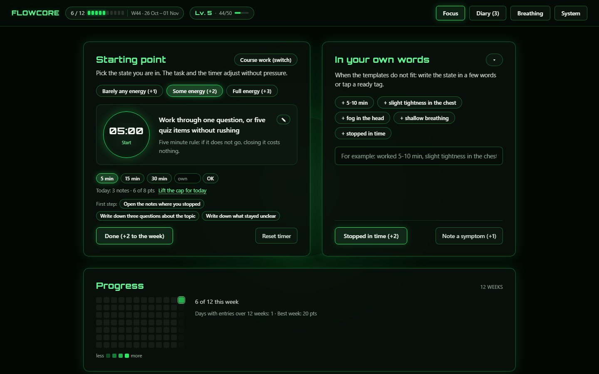
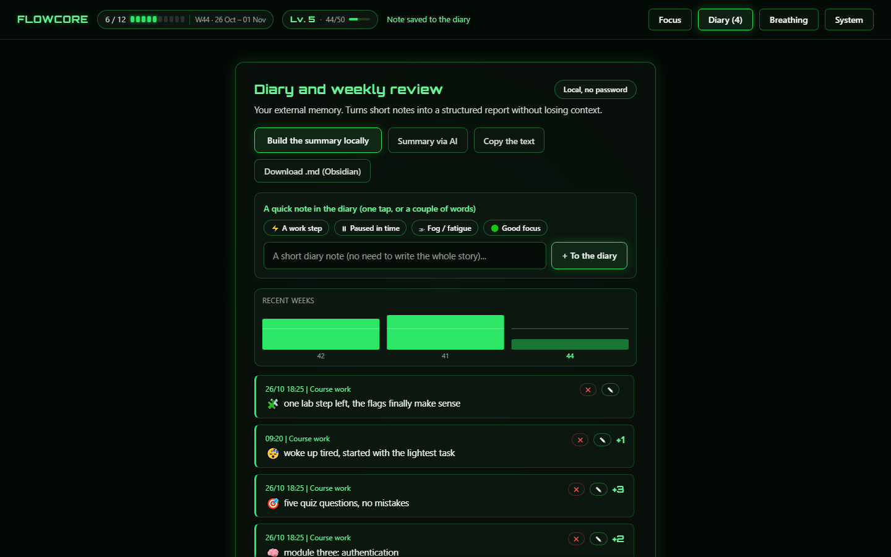
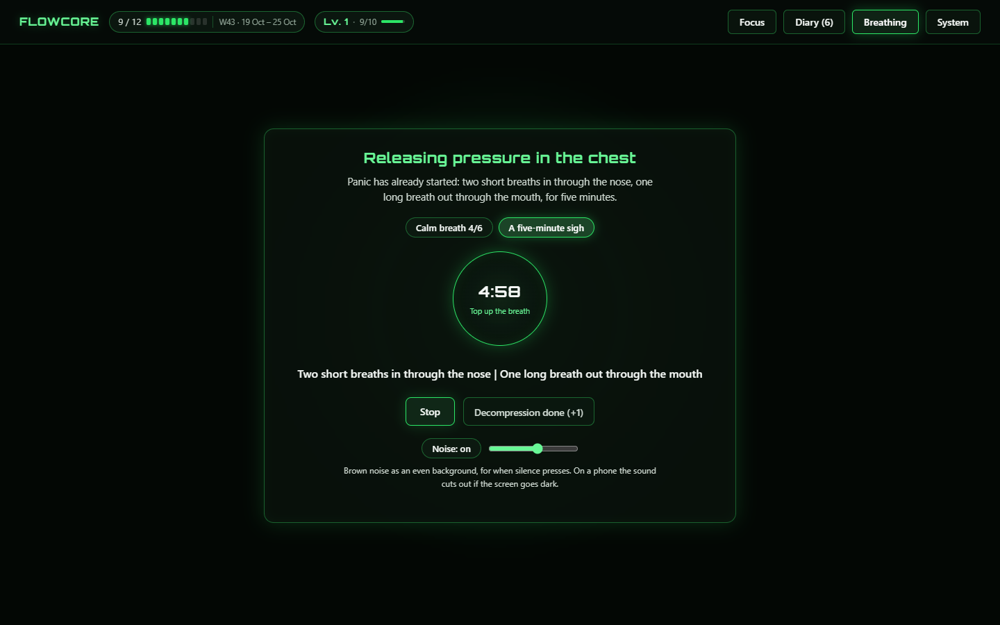
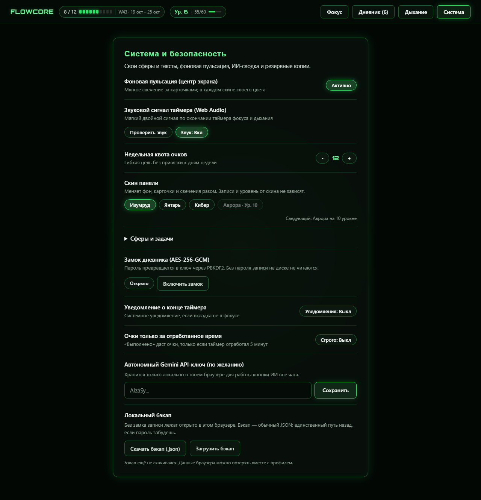
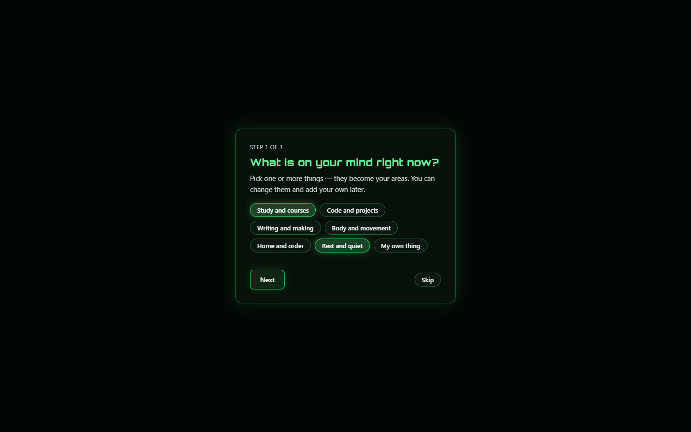
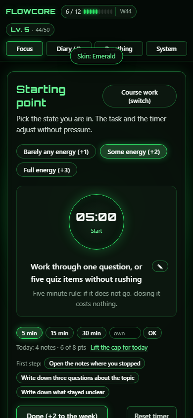
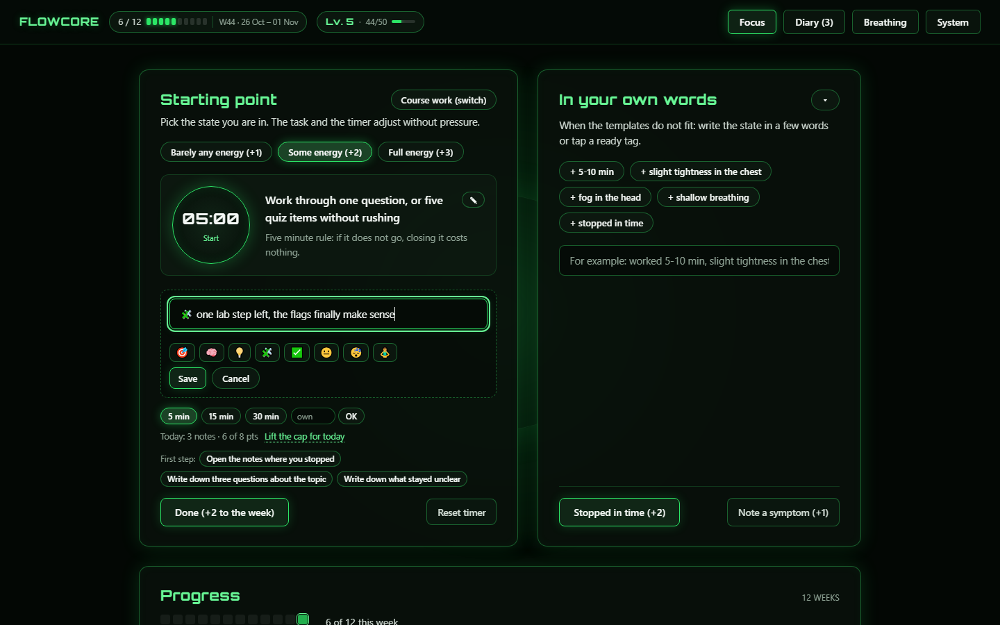
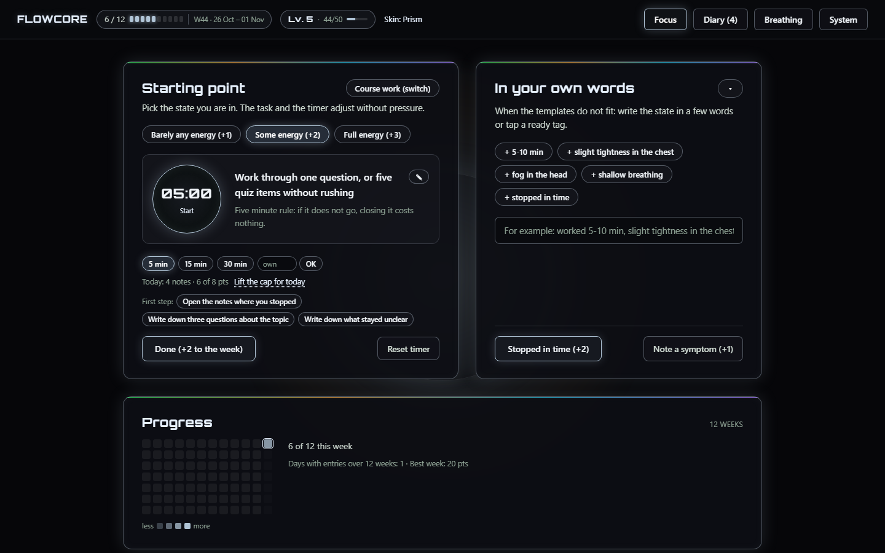

# FlowCore

[](https://github.com/averageuserr42/flowcore/actions/workflows/tests.yml)

**Дневник фокуса и восстановления для тех дней, когда час работы невозможен.**

**[Открыть FlowCore в браузере](https://averageuserr42.github.io/flowcore/)**. Ничего ставить не нужно, аккаунта нет, дневник остаётся на твоём устройстве.

*English version: [README.md](README.md).*

Выбери сферу, скажи, сколько сегодня сил, и сделай один пятиминутный шаг. Очки копятся на неделю, пропущенный день ничего не отнимает, а ранний стоп считается отдыхом, а не провалом. Всё приложение — один HTML-файл на 329 КБ: без сборки, сервера и зависимостей.

## Что умеет

Если коротко:

- Пять минут считаются работой, и остановиться на них — полный результат.
- Задача помнит, где ты остановился, и предлагает начать с этого места.
- Пропущенный день ничего не стоит: очки живут на неделе, а не на дне.
- Дневник остаётся в браузере: без аккаунта, без сервера, работает офлайн.

**Три режима по силам.** «Совсем мало сил» (+1), «Немного сил» (+2), «Полные силы» (+3). Для каждой сферы свои задачи под каждый режим — не нужно придумывать формулировку заново.

**Первый шаг вместо «поработать».** К задаче прилагаются три конкретных физических действия («открыть редактор», «прочитать последний абзац»). Пять минут считаются работой, даже если дальше не пошло.

**Заметка прямо у задачи.** Карандаш рядом с задачей открывает строку на месте, с восемью эмодзи, которые вставляются в текст. Заметка ложится в дневник под названием сферы и очков не даёт: это память, а не выполненный шаг.

**Вторая карточка уходит с дороги.** «Своими словами» сворачивается в полосу и отдаёт ширину таймеру, выбор запоминается. По умолчанию она развёрнута: прятать способ записать — не моё решение.

**Мост после остановки.** Если остановился вчера — сверху появляется «вчера остановился на: …» и кнопка «начать 5 минут с этого места». Возврат в работу не требует вспоминать, где ты был.

**Неделя, а не день.** Очки копятся на неделю (по умолчанию 12, настраивается). Пропущенный день ничего не сбрасывает; неделя закрывается в архив сама. Видно тепловую карту за 12 недель и график последних недель.

**Мягкий потолок дня: 8 очков.** После него записи идут дальше, но очки не растут — длина работы перестаёт быть единственной наградой. На хорошем дне потолок снимается одним кликом на строке «сегодня» до полуночи, а назавтра включается сам. Есть опция «очки только за отработанное время»: «Выполнено» даст очки, только если таймер честно отработал 5 минут.

**Уровень за всё время.** 10 опыта = уровень; опыт считается из всех очков за всю историю и не сгорает с неделей. Уровень открывает скины: изумруд (1), янтарь (3), призма (5), кибер (6), аврора (10) — каждый меняет палитру целиком, включая фоновую пульсацию. У призмы панель нейтральная, а по верху каждой карточки идёт тонкая статичная полоса из всех четырёх палитр.

**Отдых приносит очки.** За спокойный вчерашний день (≤6 очков) или за «вовремя остановился» начисляется заряд отдыха (до 3). Заряд добавляет +1 к следующему шагу внутри дневного лимита — быстрее закрыть норму и пойти отдыхать, а не сидеть дольше.

**Страховочный резерв (до 4 очков).** Если неделя закрылась с «ранним стопом» или выше квоты, одно очко уходит в резерв. В тяжёлую неделю его можно забрать обратно в один клик.

**Дыхание — две техники и фон.** «Спокойный выдох 4/6» на минуту и «Вздох на пять минут»: два вдоха носом и длинный выдох ртом — то, что снимает острую тревогу за пару циклов, когда минуты не хватает. Рядом — генератор коричневого шума с ползунком громкости: шум считается в браузере, ни файлов, ни сети. На телефоне звук обрывается, если погасить экран: это про пять-десять минут, а не про сон.

**Дневник и выгрузка.** Быстрые пометки в один клик, сводка локально, сводка через ИИ (если вписан свой ключ Gemini), копирование всего дневника текстом и экспорт недели в `.md` с YAML-заголовком — файл сразу ложится в Obsidian.

**Свои сферы и тексты.** Первый запуск — три вопроса: чем занята голова, сколько очков в неделю, как назвать главное дело. Пропустить можно одной кнопкой: тогда ставятся две нейтральные сферы — дело и отдых, обе на языке интерфейса. Дальше названия, задачи и шаги правятся прямо в панели.

**Четыре языка интерфейса.** Русский, украинский, английский и немецкий. Язык подхватывается из браузера при первом запуске и меняется в «Системе» — в том числе уже на экране пароля, до расшифровки дневника. Переводится оболочка: подписи, кнопки, сводки, экспорт, заготовки сфер. То, что ты написал сам, остаётся твоими словами. Ни один язык не объявлен главным: словарь — одна таблица, где все четыре стоят рядом.

**Данные остаются у тебя.** Всё лежит в localStorage браузера. Замок дневника — пароль через PBKDF2 и AES-256-GCM: без пароля файл на диске не читается. Единственный внешний запрос — необязательная ИИ-сводка в Gemini со своим ключом; Content-Security-Policy запрещает всё остальное.

**Ставится на телефон и работает офлайн.** Есть manifest, Service Worker и иконки: Android Chrome — «Установить приложение», iPhone Safari — «На экран Домой».

## Скриншоты

| Экран фокуса | Дневник и итоги недели |
| --- | --- |
|  |  |

| Дыхание: две методики и коричневый шум | Система и безопасность |
| --- | --- |
|  |  |

| Первый запуск | Телефон |
| --- | --- |
|  |  |

| Заметка у задачи | Скин «Призма» (5 уровень) |
| --- | --- |
|  |  |

Интерфейс на снимках — английский: это язык по умолчанию, остальные три переключаются в «Системе». Все скриншоты сняты на демонстрационном профиле — это не чьи-то настоящие записи.

## Быстрый старт

**Онлайн.** https://averageuserr42.github.io/flowcore/ — постоянный адрес: его можно один раз добавить на экран «Домой» и не трогать. Своя копия — по шагам ниже.

**Локально.** На GitHub нажми `Code → Download ZIP`, распакуй архив и открой `flowcore.html` двойным кликом: без сервера всё работает, кроме установки на телефон (для PWA нужен http(s)).

**С сервером и адресом для телефона.**

```bash
python serve.py            # http://localhost:8088, ничего не кэшируется
python serve.py --open     # то же, но сразу откроет браузер
python serve.py --tunnel   # временный https-адрес, чтобы поставить PWA на телефон
python serve.py --lan      # доступ в домашней сети по http (PWA не установится)
```

На Windows то же самое делает `FlowCore.cmd` — двойной клик вместо терминала.

## Публикация своей копии

1. Форк или свой репозиторий с этими файлами в корне.
2. Settings → Pages → Source: **Deploy from a branch**, ветка — та, которую создал GitHub (`main` у новых репозиториев, `master` если назвал так), папка `/ (root)`.
3. Через минуту приложение живёт по адресу `https://USERNAME.github.io/REPO/`.

Файл `index.html` нужен, чтобы адрес без имени файла открывался сразу: Pages отдаёт папку, а приложение — один `flowcore.html`.

## Структура

| Путь | Что это |
| --- | --- |
| `flowcore.html` | всё приложение: разметка, стили, логика, шрифт в base64 |
| `index.html` | редирект на `flowcore.html` для GitHub Pages |
| `serve.py` | локальный сервер; `--tunnel` поднимает временный https для телефона |
| `FlowCore.cmd` | запуск сервера двойным кликом в Windows |
| `sw.js`, `manifest.webmanifest`, `icon-*.png` | офлайн-оболочка и установка на телефон |
| `tests/run.js` | проверки логики без браузера |
| `.github/workflows/tests.yml` | прогон этих проверок на каждый push и pull request |
| `ETHICS.md` | позиция автора: для чего этот код не предназначен |
| `screenshots/` | снимки для README |

## Тесты

```bash
node tests/run.js
```

Сейчас **403 проверки**: недельный ролловер и архив, миграция старых бэкапов, замок, дневной потолок и его снятие на день, уровень и скины, резерв, бонус отдыха, заметка к задаче и набор эмодзи, методики дыхания и фазы, шум с общим выключателем звука, экспорт в Markdown, редактор сфер, интервью первого запуска, словарь на четыре языка (все ключи из разметки и кода на месте, склонения через `Intl.PluralRules`). Тесты вырезают скрипт из настоящего `flowcore.html`, поэтому проверяют именно тот файл, который открывает браузер.

Те же проверки запускаются на GitHub Actions при каждом push и pull request — файл `.github/workflows/tests.yml`. Сборки нет, поэтому шагов всего три: checkout, Node, `node tests/run.js`.

## Ограничения

- Интерфейс на четырёх языках — русский, украинский, английский, немецкий. Новый язык — это ещё одна колонка в словаре, но готового перевода на другие пока нет.
- Данные живут в одном браузере: очистка профиля или «сайт-данных» их удалит. Раз в неделю стоит скачивать бэкап JSON.
- Синхронизации между устройствами нет — это осознанно, чтобы не появлялось сервера и аккаунта.
- Всё в одном файле: правки удобны, но файл уже большой — около 329 КБ, в gzip примерно 96 КБ.

## Лицензия

MIT — бери, меняй, используй, публикуй; единственное условие — сохранить текст лицензии. См. [LICENSE](LICENSE).

Отдельно лежит [ETHICS.md](ETHICS.md) — позиция автора: код не предназначен для государственных органов, армии, спецслужб и полиции, госкомпаний, политических организаций и подрядчиков оборонки. Это **заявление, а не условие лицензии**: MIT даёт разрешение без ограничений, и этот файл его не сужает — публичный однофайловый проект всё равно невозможно проверить на «кто скачал». Люди при этом приглашаются независимо от страны и гражданства: линия проведена по структурам, а не по паспортам.
